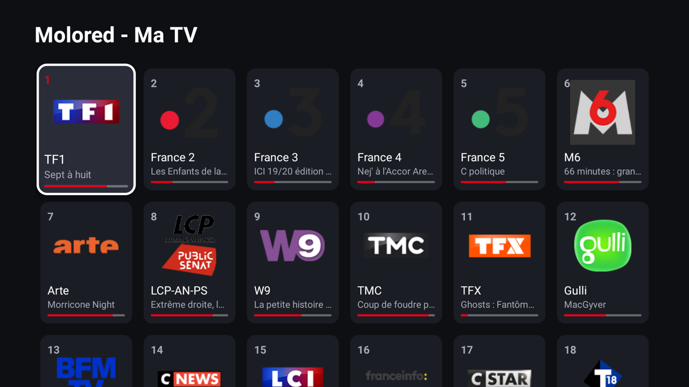
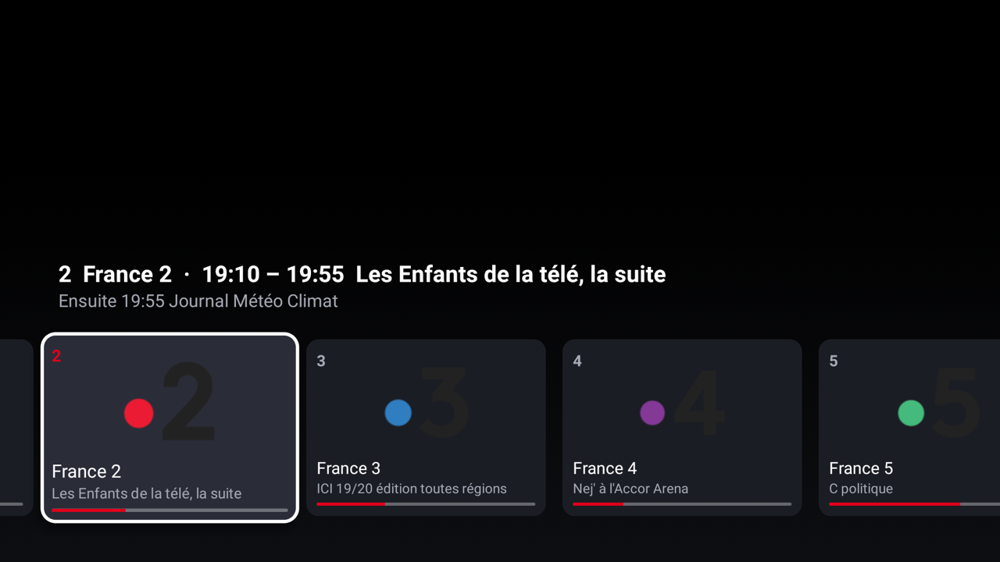
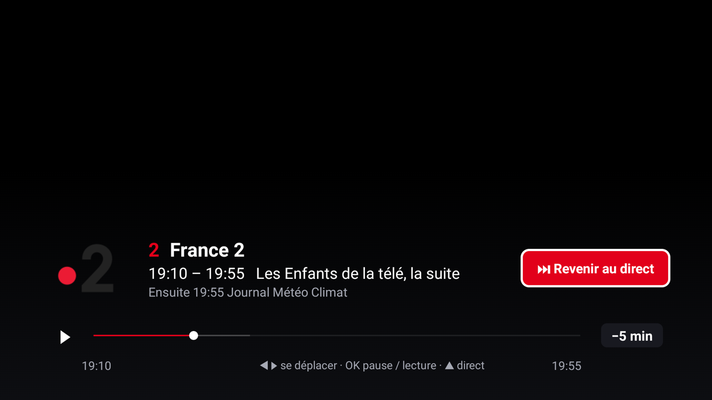

# MoloRed — "Ma TV", a simple live-TV app for Fire TV (RED by SFR / SFR TV account)

Personal-use Android TV / Fire TV client for the live channels included in a
RED by SFR (or SFR) TV subscription, with a remote-friendly UI.

> **Unofficial project.** MoloRed is a personal, non-commercial project. It is
> not affiliated with, endorsed or supported by SFR, RED by SFR or Molotov. All
> trademarks and channel logos belong to their respective owners. A valid
> RED by SFR / SFR TV subscription is required: the app only plays what your own
> account is entitled to, through SFR's own servers, and does not circumvent any
> DRM. SFR may change its API at any time and break the app.

| Channel grid | Channel strip (Down) | Control panel (Up) |
|---|---|---|
|  |  |  |

*Screenshots taken on a Fire TV Stick 4K Max. The video area is black because
Widevine-protected content cannot be captured.*

- Login **once** in the app's own screen (login + password). The credentials are
  submitted to SFR's official login form in an invisible WebView and, only if SFR
  accepts them, kept encrypted with an Android Keystore AES-GCM key. When the SFR
  session expires the app silently re-submits them, so the user is never asked
  again. Fallback button: the official SFR login page (e.g. if SFR shows a captcha).
  Menu (☰) → "Se déconnecter" erases token, cookies and saved credentials.
- Channel grid (logos, numbers, current programme).
- Opens straight into the last watched channel.
- Full-screen player:
  - Left/Right or CH+/CH- to zap, digits to type a channel number
  - Down: channel strip (same tiles as the home grid: logo, current programme,
    progress), browse with Left/Right, OK to watch, Up/Back to close
  - Up or OK: control panel — channel logo/number/name, programme now/next, and
    the time-shift bar (focused): Left/Right move the cursor (applied when you
    stop), OK = pause/play, Up = "Revenir au direct" button (OK to go live),
    Down/Back = close. Info key: classic banner.
  - Play/Pause: pause (stays paused, like a recorder); Rewind / Fast-forward:
    ±30 s per press, bigger steps when held; time-shift bar with the programme,
    playhead vs live edge, "−12 min" / DIRECT badge
  - Audio / subtitles: button in the control panel (Up, then Up again) or
    Menu (☰): French, original version (VO), audio description, other languages
    (e.g. German on Arte); subtitles in French or French for the deaf and hard of
    hearing. The choice is remembered and applied to every channel that offers it.
  - Menu (☰): restart the programme from the beginning, back to live, channel list
  - Back: back to live when delayed, else channel grid; Menu (☰) in the grid to reload or log out.
- Time-shift: the live manifest keeps ~15 min; further back (up to 8 h) or
  "restart" reloads the stream with `start=<time>` and a `RESTART` licence, as the
  web player does. Channel flags `timeShift` / `startOver` / `aff` (no fast-forward)
  are respected.
- Playback: Media3 ExoPlayer, DASH + Widevine, licence requested from SFR's own
  licence server exactly like the web player (no DRM circumvention).

API notes: [docs/sfr-tv-api.md](docs/sfr-tv-api.md).

## Build

```bash
./gradlew assembleDebug
```

APK: `app/build/outputs/apk/debug/app-debug.apk`

## Install on the Fire TV Stick

1. Fire TV: *Settings → My Fire TV → Developer options → ADB debugging: ON*
   (if Developer options are hidden: *About*, click the device name 7 times).
2. Note the IP: *Settings → My Fire TV → About → Network*.
3. From the Mac:

```bash
~/Library/Android/sdk/platform-tools/adb connect <FIRE_TV_IP>:5555
~/Library/Android/sdk/platform-tools/adb install -r app/build/outputs/apk/debug/app-debug.apk
```

Accept the "Allow USB debugging" prompt on the TV the first time.

## Limits (v1)

- SFR's concurrent-stream control (asgard session, used by the web player for
  channels flagged `isLimited`) is not implemented. As of 2026-11-15 no channel
  in SFR's list carries that flag, so every channel of the subscription plays.
- Replay / VOD not implemented: live TV only.
- Unofficial client: SFR may change its web API at any time.
